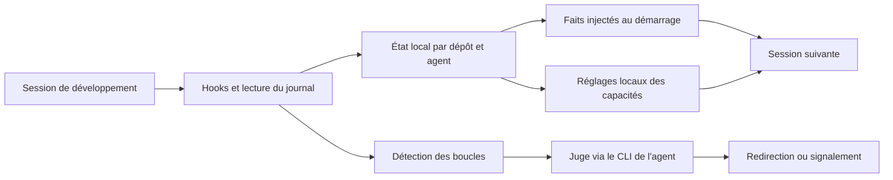

# Analyse de Microsoft TokenEconomizer

Analyse du 14 novembre 2026, révision
[`7042ea89dd5e5ecbc67ad865ad6e256e61be8bf0`](https://github.com/microsoft/TokenEconomizer/tree/7042ea89dd5e5ecbc67ad865ad6e256e61be8bf0).
Le code a été examiné dans une copie temporaire extérieure à Autostrass.
Après cette revue, le plugin a été installé sur demande utilisateur :
voir [l'installation et les réglages actuels](tokeneconomizer-installation.md).

## Avis

**Un projet de recherche sérieux à essayer sur un périmètre limité. Pour
Autostrass, son intérêt principal est la détection des boucles d'échec ; ses
économies annoncées doivent être mesurées dans notre environnement.**

TokenEconomizer optimise les sessions d'un agent de développement. Il ne réduit
pas le coût d'exécution de l'application React/Express et n'est pas une bibliothèque
à ajouter à ses dépendances npm. Son efficacité vient de ce qu'il apprend au fil
des sessions sur un même dépôt, puis applique cet apprentissage aux suivantes.

Le dépôt public, créé le 13 octobre 2026, est encore jeune. L'API GitHub indique
une publication `v0.1.0` le 26 octobre, environ 6 100 étoiles et 384 forks au
moment de la consultation. Ces chiffres de popularité ne constituent pas une
preuve de stabilité. La licence est Apache-2.0 ; le travail associe UC Berkeley,
Microsoft Research et Microsoft Security.

## Fonctionnement constaté

Le runtime Python nécessite Python ≥3.10, sans dépendance obligatoire hors
bibliothèque standard. Les intégrations utilisent les hooks des agents, des
lecteurs de journaux spécifiques à chaque agent et leurs réglages locaux.

| Mécanisme | Comportement | Défaut actuel |
|---|---|---|
| Micro-skills | Retient de courts faits opérationnels : commande de test, étape de build, particularité d'environnement. Le proposant LLM révise plusieurs sessions ; les faits doivent être confirmés et peuvent être retirés. | Désactivé |
| Tool pruning | Propose ou applique le retrait de capacités inutilisées après plusieurs sessions ; le retrait attend normalement une période d'inactivité pour éviter de réécrire le cache d'une conversation. | Automatique |
| Loopguard | Apprend une enveloppe de tours terminés sans vérification échouée après la dernière édition. Des erreurs répétées peuvent déclencher un juge puis une redirection. | Activé, une redirection par tour |

Le mode `microskills=envfacts` apprend uniquement à partir de motifs observés,
sans appel LLM pour proposer des faits. `toolprune=propose` conserve le retrait
sous forme de proposition jusqu'à application manuelle.

Le plugin ne coupe jamais lui-même le travail : après une redirection inefficace,
il signale la boucle. En `codex exec`, les messages de hooks ne sont pas affichés ;
la visibilité de ce signal est donc réduite. Les appels du juge peuvent consommer
du quota même lorsque les micro-skills sont désactivées.

L'architecture sépare les mécanismes, l'adaptation au domaine, la lecture des
traces et les transports. Les expériences sont hors du paquet distribué ; elles
partagent les mécanismes et la comptabilité avec le plugin. Cette séparation
facilite les adaptations sans introduire Docker ou les benchmarks dans le runtime.

Sources : [architecture](https://github.com/microsoft/TokenEconomizer/blob/7042ea89dd5e5ecbc67ad865ad6e256e61be8bf0/docs/ARCHITECTURE.md),
[configuration par défaut](https://github.com/microsoft/TokenEconomizer/blob/7042ea89dd5e5ecbc67ad865ad6e256e61be8bf0/tokeneconomizer/plugin/config.py#L165),
[différences entre plugin et expériences](https://github.com/microsoft/TokenEconomizer/blob/7042ea89dd5e5ecbc67ad865ad6e256e61be8bf0/docs/PLUGIN.md#L83).

## Résultats : ce qu'ils permettent de conclure

Les auteurs annoncent cinq combinaisons agent/modèle sur 277 tâches SWE-Bench
issues de six dépôts, exécutées en séquence dans chaque dépôt. Les chiffres du
README, des figures versionnées et des données de la page officielle concordent.
Ils comprennent les appels de modèle du contrôleur.

| Agent / modèle | Baisse du coût moyen annoncée | Pass@1 avant → après |
|---|---:|---:|
| Claude Code / Sonnet 5 | 23,6 % | 74,7 → 76,0 % |
| Claude Code / Opus 4.8 | 30,9 % | 74,0 → 73,0 % |
| Codex / GPT-5.6 Terra | 24,7 % | 73,8 → 74,7 % |
| Codex / GPT-5.6 Sol | 26,1 % | 80,1 → 81,7 % |
| Copilot CLI / Sonnet 5 | 18,4 % | 75,0 → 77,6 % |

La baisse de coût s'accompagne donc d'une amélioration du succès dans quatre
combinaisons sur cinq, et d'une baisse d'un point avec Opus. Cela ne garantit
pas le maintien de qualité sur chaque tâche. Les figures présentent des écarts
types ; elles ne suffisent pas à établir la significativité des petits écarts
de Pass@1.

La définition du coût tient compte des lectures du cache, de ses écritures et des
sorties, plutôt que de comparer seulement les tokens bruts. C'est un point fort.
Le suivi local exprime toutefois des **tokens équivalents à de l'entrée fraîche**,
pas une facture monétaire vérifiée ni une économie nette sur un abonnement.

Trois limites sont déterminantes : les traces et grades bruts ne sont pas
versionnés dans le dépôt examiné ; les dépôts SWE-Bench sont des projets Python,
alors qu'Autostrass combine TypeScript et MariaDB ; les contrôleurs expérimentaux
ont des politiques différentes du plugin, notamment la possibilité d'arrêter
certains runs et une politique de finalisation Codex. Nous avons contrôlé les
sources et leur cohérence, sans reproduire les benchmarks payants.

Sources : [README, résultats](https://github.com/microsoft/TokenEconomizer/blob/7042ea89dd5e5ecbc67ad865ad6e256e61be8bf0/README.md#L96),
[figure et nombres](https://github.com/microsoft/TokenEconomizer/blob/7042ea89dd5e5ecbc67ad865ad6e256e61be8bf0/docs/assets/results_overview.py#L22),
[données de la page officielle](https://tokeneconomizer.github.io/assets/js/data.js),
[comptabilité locale](https://github.com/microsoft/TokenEconomizer/blob/7042ea89dd5e5ecbc67ad865ad6e256e61be8bf0/tokeneconomizer/plugin/accounting.py#L4).

## Compatibilité et limites utiles à Autostrass

**Codex ne retire que trois groupes de capacités** : collaboration, goals et
image_media. Le code live n'offre pas le retrait des MCP ou des skills. Le plugin
ne supprimera donc pas les définitions Figma pour économiser leur coût dans Codex.
Avec Copilot, le retrait porte sur des serveurs MCP entiers ; avec Claude Code,
il peut porter sur des outils individuels.

La collaboration et `view_image` peuvent être considérés inutilisés lors de
sessions ordinaires, puis devenir nécessaires pour une revue ou une recette.
Leur retrait automatique serait gênant dans notre workflow. Une capacité
restaurée est mémorisée comme conservée et les règles personnelles sont préservées.

**Codex/Windows possède une couverture CI explicite.** La matrice utilise
Codex CLI 0.164.0 sur Ubuntu et Windows, avec un serveur de modèle local sans clé.
Le workflow de tests de la révision examinée a réussi. La phrase de documentation
« Windows beyond Claude Code … untested » est donc partiellement périmée ; cette
CI ne constitue toutefois pas une recette interactive avec notre modèle et
notre application Codex. Les commandes d'installation documentées visent le CLI.

**Copilot sous PowerShell a un problème distinct**, signalé dans
[#204](https://github.com/microsoft/TokenEconomizer/issues/204), avec correctif
[#206](https://github.com/microsoft/TokenEconomizer/pull/206) encore ouvert à la
date d'analyse. Il ne faut pas en déduire que Codex a le même défaut.

**La table tarifaire ne connaît pas GPT-6 à cette révision.** Le moteur de prix
des expériences refuse un modèle inconnu ; la comptabilité du plugin utilise
alors une courbe de repli explicitement marquée `fallback`. La
[PR #220](https://github.com/microsoft/TokenEconomizer/pull/220) reste ouverte.
Les mesures GPT-6 ne doivent pas être interprétées comme un coût exact avant
prise en charge et vérification des ratios.

**La mémoire reste propre à une machine**, sous `~/.tokeneconomizer`, séparée
par dépôt et par agent. La synchronisation OneDrive d'Autostrass ne la partage
pas automatiquement. Les difficultés entre machines sont aussi signalées dans
[#219](https://github.com/microsoft/TokenEconomizer/issues/219) et
[#193](https://github.com/microsoft/TokenEconomizer/issues/193).

Sources : [capacités Codex live](https://github.com/microsoft/TokenEconomizer/blob/7042ea89dd5e5ecbc67ad865ad6e256e61be8bf0/tokeneconomizer/plugin/denylist.py#L61),
[CI](https://github.com/microsoft/TokenEconomizer/blob/7042ea89dd5e5ecbc67ad865ad6e256e61be8bf0/.github/workflows/tests.yml#L42),
[exécution CI réussie](https://github.com/microsoft/TokenEconomizer/actions/runs/43313846118),
[repli tarifaire](https://github.com/microsoft/TokenEconomizer/blob/7042ea89dd5e5ecbc67ad865ad6e256e61be8bf0/tokeneconomizer/plugin/accounting.py#L17).

**Le signal de réussite est partiel pour nos recettes.** Le détecteur reconnaît
les commandes `npm run test:errors`, `test:api` et `test:caisse:ui`, mais pas
`npm run build`, `npm run lint` ni les appels directs de certains scripts via
`tsx` ou `node`. Un tour terminé sans vérification reconnue peut donc alimenter
l'enveloppe comme une réussite. Ce proxy ne remplace pas nos validations métier
et techniques ; il faut examiner les signalements sur les longues recettes.
Source : [détection des vérifications](https://github.com/microsoft/TokenEconomizer/blob/7042ea89dd5e5ecbc67ad865ad6e256e61be8bf0/tokeneconomizer/loopguard/turn.py#L37).

## Données et appels externes

Le stockage local ne signifie pas que tous les traitements restent locaux.
Le proposant et le juge passent par le CLI et la connexion habituelle de l'agent.
Ils transmettent des résumés des actions observées. Sur Codex, chaque appel
annexe transporte aussi le prompt de base du CLI, estimé dans le code à environ
25 000 tokens, majoritairement en cache.

La documentation décrit des résumés avec commandes, noms de fichiers édités et
erreurs masquées. Cette promesse ne vaut pas une garantie générale d'absence de
secret : des arguments ou messages d'erreur peuvent contenir des données
sensibles. Les micro-skills ouvertes sont aussi des instructions dérivées de
sorties contrôlées par le dépôt, puis réinjectées dans le contexte.

Pour Autostrass, conserver les secrets hors commandes et traces, examiner les
faits appris, et maintenir les consignes explicites sur les bases jetables,
les seeds, les migrations et l'intégrité fiscale. Un apprentissage automatique
ne remplace pas `AGENTS.md`, `passation.md` ou les preuves de recette.

Sources : [état et confidentialité](https://github.com/microsoft/TokenEconomizer/blob/7042ea89dd5e5ecbc67ad865ad6e256e61be8bf0/docs/PLUGIN.md#L723),
[appels annexes Codex](https://github.com/microsoft/TokenEconomizer/blob/7042ea89dd5e5ecbc67ad865ad6e256e61be8bf0/tokeneconomizer/plugin/sidecall.py#L14).

## Vérification et proposition d'essai

La revue a porté sur le code, les configurations, les hooks, le stockage,
les lecteurs de traces, la comptabilité, les tests et les lanceurs de benchmark.
Le runtime comprend 61 fichiers Python et environ 17 150 lignes ; 65 fichiers
Python de tests, fixtures incluses, totalisent environ 18 650 lignes. La suite
est substantielle, sans que ces volumes prouvent une couverture exhaustive.

**1 414 tests hors ligne ont été collectés et exécutés sous Windows**, avec
Python 3.13.17 et pytest 9.2.0. La
[synthèse de validation](tokeneconomizer-validation.json) conserve la commande,
l'environnement isolé, les huit échecs et les empreintes des journaux temporaires.
La première exécution donne 1 366 réussites, 38 tests ignorés et 10 échecs.
Deux échecs liés au PATH volontairement restreint ont été repris seuls avec un
PATH filtré des CLI agents et une configuration Python/Git Bash adaptée : les
deux réussissent. Le bilan des cas contrôlés est donc :

| Périmètre | Réussis | Ignorés | Échecs restants |
|---|---:|---:|---:|
| Paquet et plugin (`tests/`) | 985 | 32 | 0 |
| Expériences (`experiments/tests/`) | 383 | 6 | 8 |
| Total | 1 368 | 38 | 8 |

Les huit échecs restants concernent des hypothèses POSIX des tests expérimentaux
sur Windows : `os.getuid`, `signal.SIGHUP`, séparateurs de chemins et représentation
TOML des chemins Windows. Le harness de reproduction vise Linux x86_64.
**La suite complète n'est donc pas verte sur cette machine**, même si les cas
du paquet/plugin contrôlés réussissent après la reprise ciblée.

Les tests dits `live` du dépôt utilisent principalement des événements et traces
synthétiques ; les tests E2E optionnels de CLI sont désactivés pour cette revue.
Les fixtures isolent HOME/USERPROFILE et neutralisent les appels de modèles.
La CI standard exécute `tests/` sur Ubuntu/Windows et Python 3.10/3.13, sans
`experiments/tests/`. Elle ajoute des jobs E2E spécifiques Codex et opencode
avec modèles simulés. Nous avons consulté le résultat CI public et exécuté la
suite hors ligne ; aucune recette avec un agent réel connecté n'a été lancée.
La configuration examinée n'impose pas de seuil de couverture ni de vérification
de types mypy ou de lint Ruff. Les scripts de reproduction des benchmarks
nécessitent un environnement distinct ; les adaptateurs CredData et ReposVul
ne fournissent pas à eux seuls une reproduction complète de leur exécution.

Le manifeste SWE-Bench courant contient bien 277 tâches exécutables. D'anciens
commentaires ou listes mentionnent 229 ; la vérification des ajouts et exclusions
explique le total actuel, sans contradiction du manifeste évalué.

Il s'agit d'une analyse technique générale, sans audit de sécurité exhaustif.

Un éventuel essai devrait se faire sur une copie de travail dédiée, en conservant
les réglages et la mémoire séparés. Commencer avec `microskills=envfacts` et
`toolprune=propose`, et protéger explicitement collaboration et image_media.
Mesurer le loopguard activé puis désactivé sur des groupes de tâches comparables.
Ces réglages constituaient une proposition lors de l'analyse ; ils ont ensuite
été appliqués pour Autostrass, comme indiqué dans le guide d'installation.

Comparer le coût total, appels annexes inclus, le temps jusqu'à résultat validé,
le succès des vérifications et les interventions manuelles nécessaires. Utiliser
le même modèle et le même niveau d'effort ; distinguer la phase d'apprentissage
des sessions suivantes. Une quinzaine à une vingtaine de sessions est un premier
diagnostic pratique, sans prétention à une démonstration statistique.

La décision d'adoption dépend d'une économie répétée sans perte de qualité ni
outil nécessaire masqué. Vu notre passation déjà détaillée et Graphify, la valeur
marginale des micro-skills reste à démontrer ; le loopguard mérite davantage
l'essai, sous réserve de son coût et de ses faux signalements sur les longues recettes.

**Aucun plugin installé ou activé, aucune configuration Codex modifiée, aucun
appel LLM ou accès MariaDB effectué pendant cette analyse.** Les changements
Autostrass concernent uniquement ce rapport, sa synthèse de validation, la
passation et Graphify.
